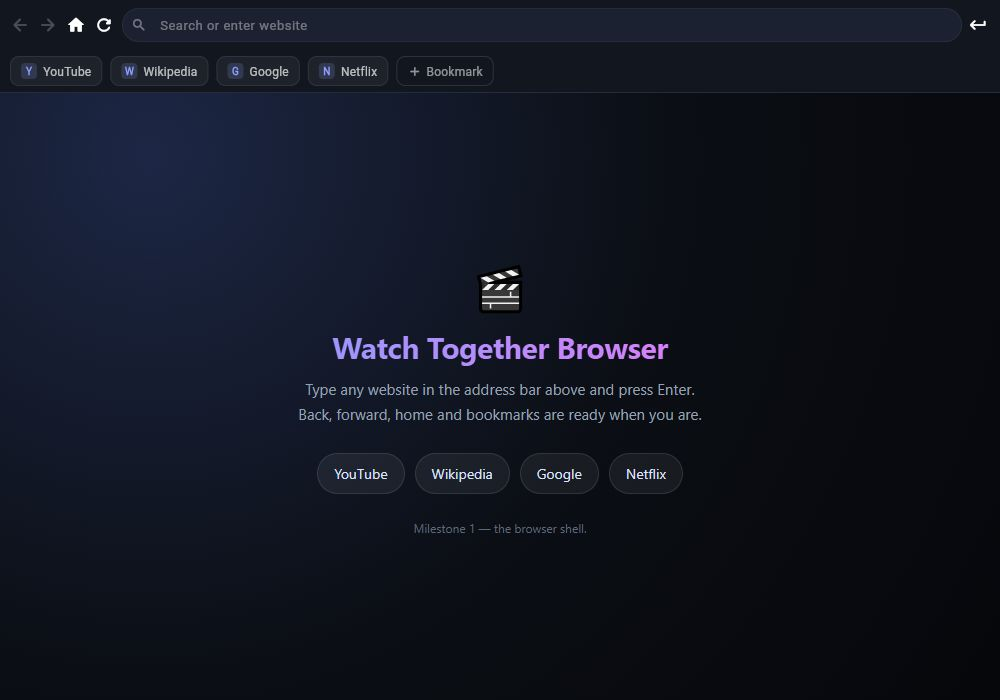

# Watch Together

A Flutter browser shell that will grow into a watch-together app.



## Milestone 1 — the browser

- Back / forward / home / reload controls
- Address bar that accepts a URL, a bare domain, or a search query
- Bookmark bar with default shortcuts, add-current-page, and long-press to remove (with undo)
- Custom dark start page
- WebView powered by `flutter_inappwebview`

## Run it

```powershell
# Web preview (Edge)
flutter run -d edge

# Android (phone or emulator connected)
flutter run

# Checks
flutter analyze
flutter test
```

## Downloads

Ready-made, split APKs are available in the
[v0.0.1 release](https://github.com/liton021/watch-together/releases/tag/v0.0.1).

## Build APKs

```powershell
# One slim APK per CPU architecture
flutter build apk --release --split-per-abi
```

Outputs in `build/app/outputs/flutter-apk/`:

| APK | Use |
|---|---|
| `app-arm64-v8a-release.apk` (16.5 MB) | Almost all modern phones |
| `app-armeabi-v7a-release.apk` (14.0 MB) | Older 32-bit phones |
| `app-x86_64-release.apk` (17.8 MB) | Emulators / Chromebooks |

All three support **Android 7.0+** (`minSdk 24`) and target Android 16
(`targetSdk 36`). They are currently signed with the debug key for
side-loading. Add a release keystore before publishing to a store. For Google
Play, build an app bundle instead (`flutter build appbundle`); Play then serves
the right split automatically.

Install one with:

```powershell
C:\Users\Liton\Android\Sdk\platform-tools\adb.exe install -r build\app\outputs\flutter-apk\app-arm64-v8a-release.apk
```

## Notes

- On the web build the page is an **iframe**, so cross-origin sites cannot
  report their URL or load state back to the toolbar, and sites that send
  `X-Frame-Options` will not render. Android uses a real WebView where all
  controls work normally.
- Android needs the internet permission, already added in
  `android/app/src/main/AndroidManifest.xml`.
- Bookmark order and edits currently live in memory only (they reset on restart).

## Next up

- Persist bookmarks
- Multiple tabs
- Rooms, synced playback and chat
